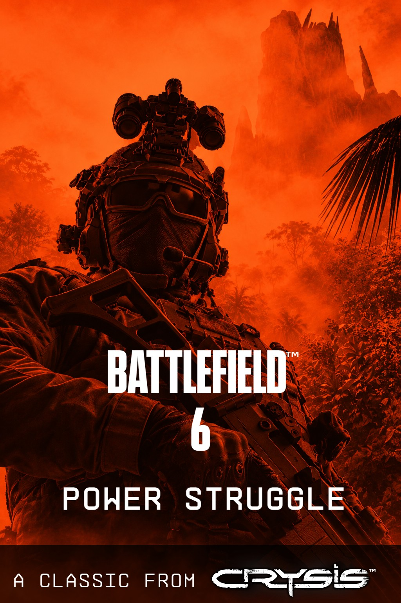
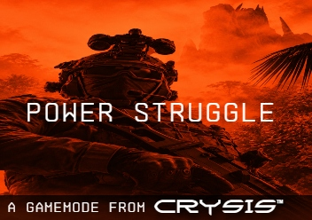

# Power Struggle

<p align="center">
  
  
</p>

A Battlefield 6 Portal game mode (TypeScript) inspired by Crysis Wars' Power
Struggle. Two teams, **NATO (team 1)** and **PAX (team 2)**, fight over bunkers,
energy sites and factories, earn prestige, break through the enemy's rocket
sites and win by blowing up the enemy HQ with the **Rorsch** raygun.

**Portal experience code: `14e11`**

> Status: work in progress on a test map (`PS_Isolated`). Numbers below are
> testing values from `src/config.ts` and will be tuned. Some debug switches
> are still on for testing (see [Debug menu](#debug-menu)).

## How a match plays

### 1. Capture the map

| Objective | How it's captured | What it gives |
|---|---|---|
| **Bunkers** (3) | Native Conquest capture point (20 s) | A forward spawn in the normal deploy menu; 150 prestige |
| **Energy sites** (3) | Stand in the area; custom capture (20 s) | Charges your Prototype Factory; 200 prestige |
| **Prototype Factory** (1) | Custom capture | Required for your team's power to charge at all |
| **War / Aviation / Naval factories** | Custom capture | Lets your team buy vehicles there; 250 prestige |

Custom captures work like Crysis: only one team in the area advances the bar,
the other team's progress decays, and a contested area freezes. Only the players
standing in the area when it flips get paid.

### 2. Earn prestige and spend it

Prestige is the spendable currency: kills (50), assists (25) and captures
(above). The scoreboard score is tracked separately and can't be spent.

The **buy menu** opens from the Portal gadget and has these tabs:

- **Weapons**: prototype tier (MOAC, ...) and standard tier, including the
  Rorsch.
- **Equipment** and **Add-ons**: tools, ammo, scopes.
- **Factory**: buy a vehicle at a factory your team owns. It spawns on a free
  pad. A placed vehicle spawner that is still tied to an earlier vehicle is
  replaced by a spawner created at runtime, so a purchase only fails when every
  pad is physically blocked; if nothing appears, the prestige is refunded.
- **Tactical**: a list of every strategic location showing Friendly / Enemy /
  Neutral. Picking one highlights its world icon for you only.

### 3. Charge power

A team that owns the **Prototype Factory** charges its **Power Level** from 0 to
100%. Each energy site it holds speeds this up (1.5× per site; 0 sites = no
charge). Both teams are told when either side passes 50%, 75% and 100%.

### 4. Break the rocket sites

Each team's base is guarded by three **rocket sites** (`src/rocketsites/`): a
turning radar and a battery of 12 missile silos. A human enemy entering a
site's kill zone is warned ("ENEMY ROCKET SITE - leave now!"), locked by the
radar for 3 seconds, then hit by a homing rocket that can't be escaped, on foot
or in any vehicle. The sites ignore bots. The radar only turns while someone is
near it.

A site falls to 8 hits on its radar from unguided, high-explosive or
aim-guided rocket launchers, or to a single Rorsch shot, and stays down for the
rest of the match. Both teams are told when a site falls ("Enemy rocket site
destroyed (1/3)" / "Our rocket site was destroyed (1/3)").

Once **2 of a team's 3 sites** are down, its HQ is open: the attackers are told
to hit it with the Rorsch, the defenders that their HQ is exposed.

### 5. Destroy the HQ with the Rorsch

The **Rorsch** is a raygun: it charges for about 2 seconds and fires an instant,
straight shot that lands slightly below the crosshair (about 3° low, so ~6 m
at 100 m). From anywhere on the map, the shot:

- **destroys an enemy rocket site in one hit** when it passes through its
  radar. Your own team's sites are immune;
- **damages an open enemy HQ** when it lands within 350 m of it. 3 hits
  (100 → 67 → 33 → 0%) destroy it, and that team **loses the match**. A hit
  on an HQ that its rocket sites still protect does nothing.

Wherever it lands, every Rorsch impact is a small tactical nuke, friendly fire
included:

| Distance from the impact | Effect |
|---|---|
| up to 35 m | killed (black screen) |
| up to 55 m | heavy damage, burning, a white flash, ringing and a disoriented few seconds |
| up to 150 m | sees the blast |

Nearby players hear an alarm while the Rorsch charges. A purchase holds two
shots; the Rorsch is taken away after the second, and dropping it and picking
it back up does not refill it.

## Bots

Each team is filled with up to 32 script-controlled bots (`src/bots*.ts`),
leaving room for the humans on that team. Bots stay in the game when they die
and redeploy as the same soldier, so their name and scoreboard row last the
whole match. Some deploy straight onto a bunker their team owns. Every few
seconds each bot scores every objective and picks one:

- **attack** anything its team doesn't own;
- **defend** an owned objective with enemies nearby;
- **hold** a safe one for a while, then **roam** to another.

Bots heading to the same place count against it, so the team spreads out. Long
walks follow a waypoint graph built from small props placed on the map (ObjIds
9000-9199, read from the map export at build time); a route a bot swam on or got
stuck on becomes more expensive for everyone. A bot that can't reach an
objective skips it for 90 s, and one stuck in place for a while jumps, re-plans,
and as a last resort respawns. When shot, a bot fights for 10 s, then goes back
to its objective.

Vehicles: bots with a long trip get into a free vehicle nearby and drive or fly
it toward their objective. Teammate bots near a player's vehicle that has
landed or stopped climb in as passengers, ride along, and get out once the
player has carried them somewhere and stopped.

## Debug menu

The buy menu has a **Debug** tab for testing. Besides the HUD and power test
controls, its Utility section has:

- **Site damage**: whether rocket-site rockets hurt anyone, for everyone on
  the server. Off at the start of every match.
- **Replenish ammo**: refills the ammo, grenades, launcher rockets and gadgets
  of the player who presses it, and a carried Rorsch back to two shots.
- **Team**, **Prestige**, **Rorsch Check**, **Admin logs**, **Reset** and the
  performance readouts (tick rate, frame time, bots).

Switches to turn off for real matches: `WEAPONS_TAB_FREE` (every Weapons item
costs 0), `BOT_TRACE` and `RORSCH_TRACE` in `src/config.ts`, and `LOG_LEVEL` in
`src/rocketsites/config.ts`.

## The map

`PS_Isolated.tscn` is the Godot scene and `PS_Isolated.spatial.json` its Portal
export. The script finds map objects by ObjId; `PS_ObjIds.md` lists every
block. The ones that matter most:

| ObjIds | What |
|---|---|
| 1, 2 | The team 1 and team 2 HQs. A Rorsch hit is measured from here. |
| 8100–8399 | Team 1 rocket sites (one 100-block each: 8100, 8200, 8300) |
| 8500–8799 | Team 2 rocket sites (8500, 8600, 8700) |
| 9000–9199 | Bot navigation waypoints |

Inside a site's block: `x00` kill zone, `x01` radar animation zone, `x10`–`x19`
radar parts (the pillar `x10` is the pivot), `x20`–`x39` silos. **A site copied
in Godot keeps the original's ObjIds**: renumber the copy into its own block,
or the build stops with "ObjId ... is used more than once".

The HQ positions, the rocket sites and the waypoints are read from the export
at build time, so after moving any of them: re-export, then `npm run build`.

## Project layout

| Path | What it is |
|---|---|
| `src/index.ts` | Entry point: HUD, buy menu, debug menu, events |
| `src/capture.ts`, `energy.ts`, `factory.ts` | Custom capture, energy sites, power charge |
| `src/spawns.ts`, `buildings.ts` | Bunker capture points and spawning |
| `src/nuke.ts`, `rorschshot.ts`, `nukefx.ts`, `rorschammo.ts` | The Rorsch shot and ray, the nuke and its screen effects, shots per purchase |
| `src/rocketsites/` | The rocket sites: radar, launchers, rockets, damage (`sitemap.ts` is generated) |
| `src/sitewire.ts` | Links the rocket sites to the mode: HQ opening, feed messages, Rorsch one-shot |
| `src/hq.ts`, `hqpos.ts` | HQ damage and the win (`hqpos.ts` is generated) |
| `src/winner.ts` | End-of-match rules |
| `src/bots.ts`, `botbrain.ts`, `botscore.ts`, `botobjectives.ts`, `botnames.ts` | Bot AI |
| `src/botnav.ts`, `botnavgraph.ts`, `navpoints.ts` | Waypoint graph and routing (`navpoints.ts` is generated) |
| `src/slots.ts` | Vehicle purchases, pads and runtime spawners |
| `src/worldicons.ts` | Strategic locations and the Tactical tab's highlights |
| `src/objids.ts` | The map's object IDs (see `PS_ObjIds.md`) |
| `src/config.ts` | Every tunable number |
| `src/strings.json` | All on-screen text |
| `PS_Isolated.tscn` / `.spatial.json` | The Godot test map and its Portal export |
| `ps_poster_1.jpg`, `ps_map_thumbnail_1.jpg` | Poster and thumbnail art |
| `scripts/` | Generators that read the map, Node unit tests for the pure modules, and the build guard |
| `dist/` | Built output to upload to Portal |

## Building

The build expects this folder to sit next to `main_resources/` (the Portal SDK
type definitions and `bf6-portal-utils`), as in the original workspace.

```bash
npm install
npm run build
```

`npm run build` regenerates the waypoint table, the HQ positions and the rocket
sites from the map export, runs the source guard and unit tests, type-checks,
bundles, and type-checks the bundle. Upload `dist/bundle.ts` and
`dist/bundle.strings.json` to the Portal web editor together with the map
export.

## Credits

- [**bf6-portal-utils**](https://github.com/deluca-mike/bf6-portal-utils) by
  deluca-mike: the utility library this mode is built on (events, timers,
  logging, performance stats, callback handler, player locations, vectors,
  raycast queue and the player undeploy fixer).
- [**bf6-portal-bots-brain**](https://github.com/nikgodda/bf6-portal-bots-brain/tree/main)
  by nikgodda: ideas behind the bot AI, in particular handing a shot bot to the
  combat AI for a short time and steering bot-driven vehicles toward an objective.
- [**bf6-portal-ui-preview**](https://github.com/nadorjozsef/bf6-portal-ui-preview)
  by nadorjozsef: used to preview the HUD and buy menu layouts during development.

## License

[MIT](LICENSE). `dist/bundle.ts` also contains code from bf6-portal-utils, which
is MIT licensed, Copyright (c) 2026 Michael De Luca.
